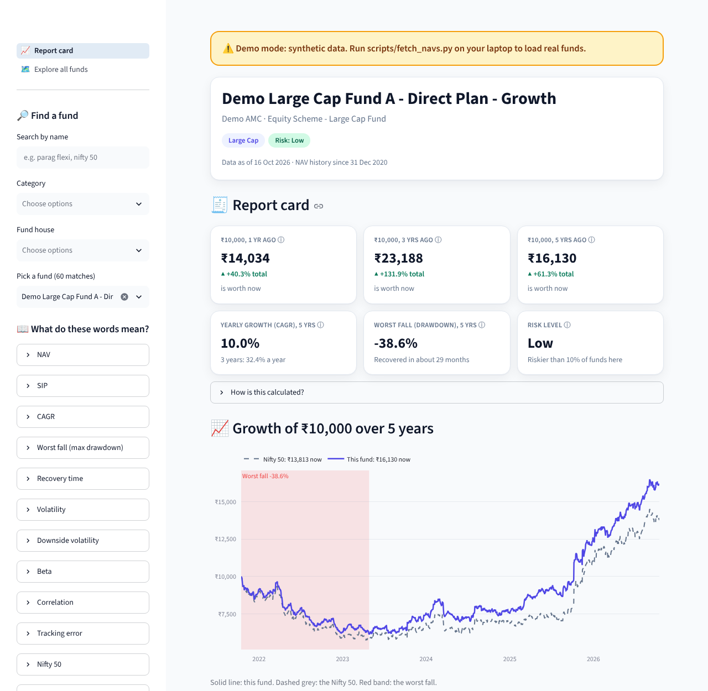

# Fund Explained

Pick any Indian mutual fund and get a plain-English report card: what ₹10,000 would have become, its worst fall, how risky it is next to the Nifty, which funds it behaves like, and whether it behaves like its official category. **It explains and never recommends.**



> ⚠️ **This build runs on synthetic demo data.** The overnight build environment couldn't reach mfapi.in (blocked by its proxy), so the app currently shows clearly labelled "Demo …" funds behind an amber banner. Real data is one script away: see [`docs/MORNING_STEPS.md`](docs/MORNING_STEPS.md).

## What it shows

- **Report card:** ₹10,000 invested 1, 3 and 5 years ago, yearly growth (CAGR), worst fall (max drawdown) and how long it took to recover, and a relative risk level.
- **Risk vs the Nifty:** beta ("when the Nifty rises 1%, this fund has typically risen about 0.95%"), correlation and volatility.
- **Lookalikes (ML):** the 5 funds whose daily returns moved most like this one over the last 3 years.
- **Label check (ML):** a classifier guesses each fund's category from its behaviour. Funds that confidently look like a *different* category are flagged, with careful wording: behaviour isn't holdings.
- **Explore:** every fund on a 2D map coloured by k-means cluster, plus the full evaluation report.
- **Glossary:** one-line explanations of NAV, CAGR, drawdown, beta and more. Every number has a "How is this calculated?" note.

## Run it

```bash
pip install -r requirements.txt
streamlit run app/streamlit_app.py
```

Development:

```bash
pip install -r requirements-dev.txt
ruff check .
pytest
python -m fundx.ml --report      # regenerate docs/EVALUATION.md
python -m fundx.data --summary   # regenerate docs/DATA_SUMMARY.md
```

To load real data (on a machine that can reach mfapi.in), run `python scripts/fetch_navs.py --out data`. The app and tests then use `data/` automatically instead of `data/demo/`.

## Key findings

**These are demo-data numbers. They show that the pipeline works, not anything about real funds.** In the synthetic data the categories were *built* with different factor loadings, so the models are recovering the generator. The section gets rewritten with real numbers once `docs/EVALUATION.md` is regenerated on real data.

| Check | Result (demo data) |
|---|---|
| Funds | 60 synthetic (5 equity categories + 3 Nifty 50 index funds) |
| Lookalike sanity: each Nifty 50 index fund's top lookalike is another one (corr ≥ 0.99) | 100% (3 of 3) |
| k-means, best k by silhouette | k = 3, silhouette 0.37, adjusted Rand index vs categories 0.24 |
| k-means at k = number of categories (6) | ARI 0.40 |
| Category classifier, 5-fold stratified CV | Random forest 82.5% accuracy (macro-F1 0.84); logistic regression 70.2%; majority-class baseline 17.5% |
| Funds flagged as "behaves like another category" (prob ≥ 0.7) | 3 |

The full, generated report is in [`docs/EVALUATION.md`](docs/EVALUATION.md). The data description is in [`docs/DATA_SUMMARY.md`](docs/DATA_SUMMARY.md).

## How it works

```
scripts/fetch_navs.py   mfapi.in → data/schemes.csv + data/navs.parquet (run once, offline after)
fundx/data.py           load, align on trading days, forward-fill gaps ≤ 5 days, daily returns
fundx/metrics.py        growth of ₹10k, CAGR, drawdown + recovery, volatility, beta, risk label
fundx/benchmark.py      picks the Nifty 50 proxy (oldest plain Nifty 50 index fund)
fundx/lookalikes.py     3-year return correlations → top-5 lookalikes
fundx/features.py       8 behaviour features per fund
fundx/ml.py             k-means + category classifier + evaluation report
fundx/report.py         per-fund report card and plain-English wording
app/                    Streamlit app (report card + explore page)
```

Design notes and every judgement call are in [`docs/DECISIONS.md`](docs/DECISIONS.md).

## Limitations

- **Past behaviour only.** Nothing here predicts future returns.
- **Survivorship bias.** Only funds alive today with ≥ 5 years of history are included. Closed or merged funds (often the weaker ones) are missing.
- **Direct plan, Growth option only.** No Regular plans or IDCW options.
- **No expense ratios or holdings.** The label check sees prices, not portfolios: a flag is a prompt to look at the portfolio, not a verdict.
- **The Nifty 50 is approximated** by one Nifty 50 index fund's NAV (small fees and tracking error included).
- **Risk labels are relative** to the funds in this dataset. "Low" here is still an equity fund.

## Data and credits

NAV history and scheme details from [mfapi.in](https://www.mfapi.in/), which republishes NAVs from AMFI (Association of Mutual Funds in India). The app never calls any network service: it only reads the committed files.

_Educational tool. Past performance does not indicate future returns. Not investment advice._
